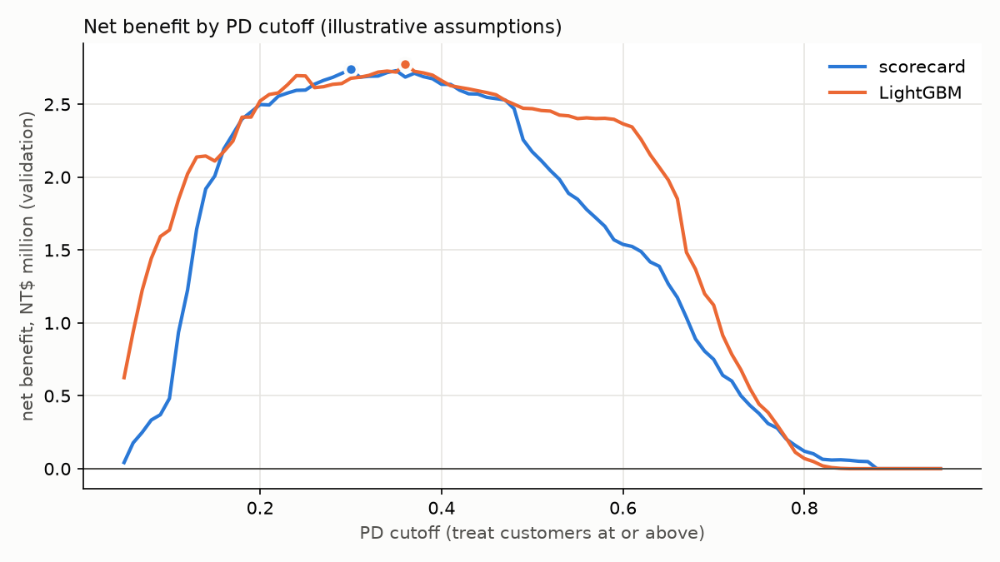

# Cutoff and business impact

## Assumptions (ILLUSTRATIVE, chosen by the analyst, not facts about any real bank)
| lgd | effect | outreach_cost | false_alarm_cost |
|---|---|---|---|
| 0.60 | 0.20 | 100.00 | 1,500.00 |

Exposure = latest bill (BILL_AMT1, floored at 0). Amounts in NT$. Net benefit uses REALIZED outcomes on the validation sample, versus doing nothing. See the module docstring in business.py for the full logic.

## Chosen cutoffs (selected on validation, then frozen for the one-time test run)
| model | cutoff | net_benefit | treated_share | precision | recall | net_ci_low | net_ci_high |
|---|---|---|---|---|---|---|---|
| scorecard | 0.300 | 2,740,180.000 | 0.219 | 0.522 | 0.517 | 2,296,331.723 | 3,279,105.342 |
| LightGBM | 0.360 | 2,777,213.120 | 0.167 | 0.593 | 0.447 | 2,346,153.180 | 3,289,460.608 |

Paired difference in net benefit (LightGBM minus scorecard), NT$: 37,033, 95% bootstrap interval -172,129 to 208,418.

These validation figures are optimistic: the cutoff was chosen where validation looks best.

## Simple baselines on the same customers
| policy | net_benefit | treated_share | recall |
|---|---|---|---|
| treat nobody | 0.000 | 0.000 | 0.000 |
| treat everybody | -99,817.320 | 1.000 | 1.000 |

## Sensitivity of the scorecard's best cutoff to the assumptions
| effect | false_alarm_cost | best_cutoff | net_benefit |
|---|---|---|---|
| 0.10 | 500.00 | 0.30 | 1,461,190.00 |
| 0.10 | 1,500.00 | 0.47 | 1,019,430.70 |
| 0.10 | 3,000.00 | 0.48 | 604,133.88 |
| 0.20 | 500.00 | 0.06 | 4,652,196.80 |
| 0.20 | 1,500.00 | 0.30 | 2,740,180.00 |
| 0.20 | 3,000.00 | 0.47 | 2,114,361.40 |
| 0.30 | 500.00 | 0.06 | 8,386,995.20 |
| 0.30 | 1,500.00 | 0.30 | 4,646,170.00 |
| 0.30 | 3,000.00 | 0.37 | 3,795,043.16 |

