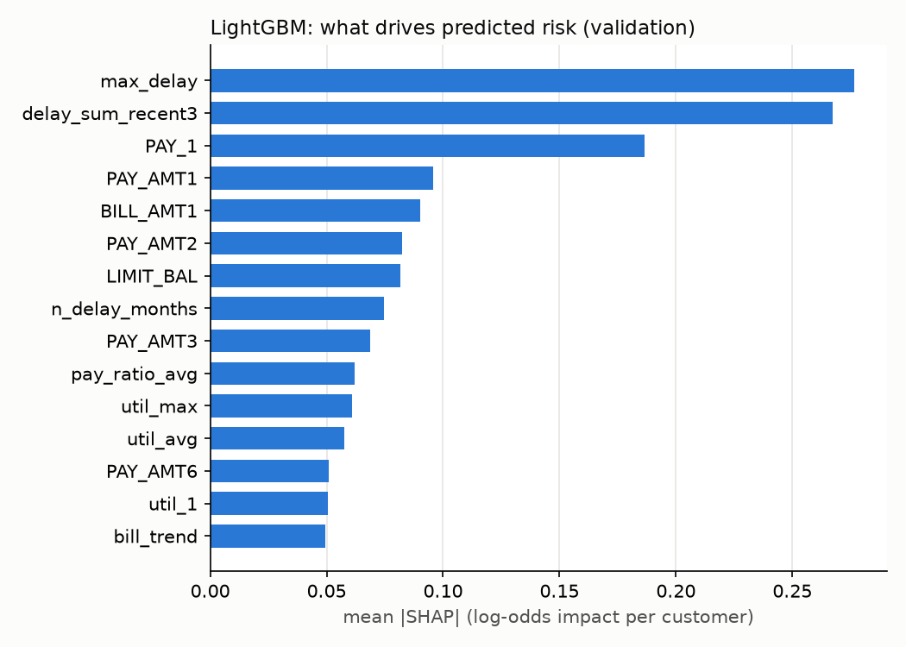

# Explainability report

SHAP values describe the LightGBM challenger; reason codes describe the scorecard. Both are computed on validation customers.

SHAP additivity check (base value + sum of SHAP = model output): largest gap 5.33e-15.

## Global drivers (mean |SHAP|, top 15)
| feature | mean_abs_shap |
|---|---|
| max_delay | 0.2766 |
| delay_sum_recent3 | 0.2672 |
| PAY_1 | 0.1866 |
| PAY_AMT1 | 0.0957 |
| BILL_AMT1 | 0.0903 |
| PAY_AMT2 | 0.0824 |
| LIMIT_BAL | 0.0815 |
| n_delay_months | 0.0745 |
| PAY_AMT3 | 0.0689 |
| pay_ratio_avg | 0.0620 |
| util_max | 0.0608 |
| util_avg | 0.0575 |
| PAY_AMT6 | 0.0508 |
| util_1 | 0.0507 |
| bill_trend | 0.0495 |

## Example declined customer (ID 9094; scorecard PD 65.9%, LightGBM PD 69.0%)
Chosen mechanically as the median-PD customer among those above 50% PD; NOT hand-picked.

### Scorecard reason codes (points below the average customer)
| feature | points_vs_average | reason | value |
|---|---|---|---|
| PAY_1 | -41.63 | Latest repayment status (Sept) | 2.00 |
| max_delay | -11.24 | Longest payment delay in 6 months | 2.00 |
| PAY_AMT2 | -5.78 | Low payment amount 2 month(s) ago | 0.00 |
| PAY_AMT3 | -4.02 | Low payment amount 3 month(s) ago | 0.00 |

### LightGBM top risk-raising SHAP contributions
| feature | value | shap_log_odds | reason |
|---|---|---|---|
| delay_sum_recent3 | 2.000 | 0.738 | Recent (3-month) delinquency |
| PAY_1 | 2.000 | 0.716 | Latest repayment status (Sept) |
| max_delay | 2.000 | 0.501 | Longest payment delay in 6 months |
| PAY_AMT3 | 0.000 | 0.126 | Low payment amount 3 month(s) ago |
| BILL_AMT5 | 0.000 | 0.099 | Bill amount 5 month(s) ago |

Caveats: SHAP shows how the model uses features, not causes. Reason-code wording and the comparison baseline (average customer) are design choices; adverse-action rules vary by jurisdiction (verify).
