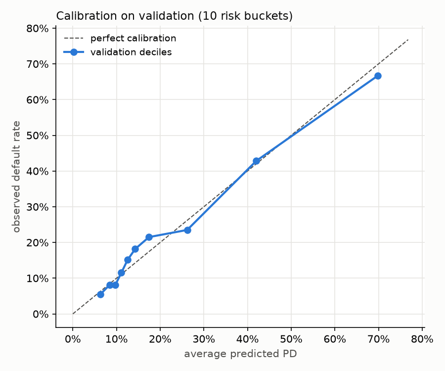

# Scorecard report (logistic regression on WoE features)

Validation is used to REPORT only; the test split has not been touched. Splits are random and stratified (the data has no usable time dimension), so performance may be optimistic relative to a true out-of-time test.

## Feature selection log (all decisions use training data)
| dropped | reason |
|---|---|
| BILL_AMT1_woe | IV 0.006 < 0.02 |
| BILL_AMT2_woe | IV 0.006 < 0.02 |
| BILL_AMT3_woe | IV 0.005 < 0.02 |
| BILL_AMT4_woe | IV 0.004 < 0.02 |
| BILL_AMT5_woe | IV 0.004 < 0.02 |
| BILL_AMT6_woe | IV 0.007 < 0.02 |
| n_delay_months_woe | corr 0.89 with higher-IV delay_sum_recent3_woe |
| util_max_woe | corr 0.87 with higher-IV util_avg_woe |
| delay_sum_recent3_woe | VIF 21.7 > 5.0 |
| util_1_woe | VIF 5.1 > 5.0 |
| PAY_2_woe | positive coefficient +0.009 (expected negative) |
| pay_ratio_1_woe | positive coefficient +0.054 (expected negative) |
| pay_ratio_avg_woe | p-value 0.348 > 0.05 |
| PAY_AMT5_woe | p-value 0.269 > 0.05 |
| PAY_3_woe | p-value 0.247 > 0.05 |
| PAY_AMT6_woe | p-value 0.094 > 0.05 |
| bill_trend_woe | p-value 0.068 > 0.05 |

## VIF before the sign/significance pruning
| feature | vif |
|---|---|
| delay_sum_recent3_woe | 21.69 |
| PAY_1_woe | 6.63 |
| PAY_3_woe | 6.50 |
| util_1_woe | 5.10 |
| util_avg_woe | 4.17 |
| max_delay_woe | 4.11 |
| PAY_2_woe | 3.95 |
| pay_ratio_1_woe | 3.59 |
| pay_ratio_avg_woe | 3.02 |
| PAY_5_woe | 2.97 |
| PAY_4_woe | 2.92 |
| PAY_AMT1_woe | 2.92 |
| PAY_6_woe | 2.36 |
| PAY_AMT5_woe | 2.13 |
| LIMIT_BAL_woe | 2.07 |
| pay_to_limit_woe | 2.07 |
| PAY_AMT4_woe | 2.06 |
| PAY_AMT3_woe | 2.02 |
| PAY_AMT2_woe | 1.98 |
| PAY_AMT6_woe | 1.82 |
| bill_trend_woe | 1.45 |

## Final model coefficients (expected negative on WoE features)
| feature | coef | std_err | p_value |
|---|---|---|---|
| PAY_1_woe | -0.6362 | 0.0267 | 0.0000 |
| max_delay_woe | -0.2933 | 0.0346 | 0.0000 |
| PAY_4_woe | -0.1265 | 0.0485 | 0.0092 |
| PAY_5_woe | -0.1186 | 0.0556 | 0.0329 |
| PAY_6_woe | -0.1574 | 0.0497 | 0.0016 |
| LIMIT_BAL_woe | -0.2148 | 0.0612 | 0.0005 |
| PAY_AMT1_woe | -0.1625 | 0.0597 | 0.0065 |
| PAY_AMT2_woe | -0.3368 | 0.0658 | 0.0000 |
| PAY_AMT3_woe | -0.2602 | 0.0793 | 0.0010 |
| util_avg_woe | -0.4968 | 0.0806 | 0.0000 |
| PAY_AMT4_woe | -0.2138 | 0.0891 | 0.0164 |
| pay_to_limit_woe | -0.2747 | 0.1279 | 0.0317 |

Intercept: -1.2537. Features kept: 12. Max VIF in final model: 2.90.

## Performance
| split | auc | gini | ks | brier |
|---|---|---|---|---|
| train | 0.7783 | 0.5566 | 0.4216 | 0.1347 |
| validation | 0.7648 | 0.5296 | 0.3906 | 0.1398 |

Validation AUC 95% bootstrap interval: 0.7506 to 0.7803 (1,000 resamples, seed 42).
Points scorecard (rounded integers) validation AUC 0.7649, KS 0.3884; largest gap to the unrounded model score: 3.19 points.

Rules of thumb for KS and Gini vary by portfolio; compare against a challenger, not a fixed bar.

## Calibration by risk bucket (validation)
| bucket | customers | avg_predicted_pd | observed_default_rate |
|---|---|---|---|
| 1 | 600 | 0.0630 | 0.0550 |
| 2 | 600 | 0.0847 | 0.0817 |
| 3 | 600 | 0.0975 | 0.0817 |
| 4 | 600 | 0.1110 | 0.1150 |
| 5 | 600 | 0.1256 | 0.1517 |
| 6 | 600 | 0.1427 | 0.1817 |
| 7 | 600 | 0.1743 | 0.2150 |
| 8 | 600 | 0.2618 | 0.2350 |
| 9 | 600 | 0.4200 | 0.4283 |
| 10 | 600 | 0.6980 | 0.6667 |

## Scorecard scaling (illustrative convention)
Base score 600 at 50:1 good:bad odds, 20 points to double the odds (Factor 28.854, Offset 487.123). These are common textbook choices, not requirements.

## Points table
| feature | bin | woe | count | default_rate | points |
|---|---|---|---|---|---|
| PAY_1 | < -1 | 0.7261 | 1,666 | 0.1206 | 57 |
| PAY_1 | [-1, 0) | 0.3313 | 3,383 | 0.1694 | 50 |
| PAY_1 | [0, 1) | 0.6634 | 8,805 | 0.1277 | 56 |
| PAY_1 | [1, 2) | -0.5726 | 2,245 | 0.3350 | 33 |
| PAY_1 | >= 2 | -2.1082 | 1,901 | 0.7007 | 5 |
| max_delay | < 1 | 0.7884 | 11,902 | 0.1144 | 50 |
| max_delay | [1, 2) | -0.0986 | 1,019 | 0.2385 | 43 |
| max_delay | >= 2 | -1.1310 | 5,079 | 0.4682 | 34 |
| PAY_4 | < -1 | 0.2755 | 2,611 | 0.1773 | 45 |
| PAY_4 | [-1, 0) | 0.4110 | 3,402 | 0.1584 | 45 |
| PAY_4 | [0, 2) | 0.2172 | 9,861 | 0.1861 | 44 |
| PAY_4 | >= 2 | -1.4127 | 2,126 | 0.5386 | 38 |
| PAY_5 | < -1 | 0.2447 | 2,760 | 0.1819 | 44 |
| PAY_5 | [-1, 0) | 0.3312 | 3,324 | 0.1694 | 45 |
| PAY_5 | [0, 2) | 0.1992 | 10,136 | 0.1888 | 44 |
| PAY_5 | >= 2 | -1.5134 | 1,780 | 0.5635 | 38 |
| PAY_6 | < -1 | 0.1993 | 2,967 | 0.1887 | 45 |
| PAY_6 | [-1, 0) | 0.3118 | 3,422 | 0.1721 | 45 |
| PAY_6 | [0, 2) | 0.1998 | 9,722 | 0.1887 | 45 |
| PAY_6 | >= 2 | -1.3715 | 1,889 | 0.5283 | 37 |
| LIMIT_BAL | < 5e+04 | -0.7216 | 2,591 | 0.3690 | 39 |
| LIMIT_BAL | [5e+04, 8e+04) | -0.2658 | 2,918 | 0.2704 | 42 |
| LIMIT_BAL | [8e+04, 1.4e+05) | -0.0789 | 3,177 | 0.2351 | 43 |
| LIMIT_BAL | [1.4e+05, 2.1e+05) | 0.2319 | 3,541 | 0.1838 | 45 |
| LIMIT_BAL | [2.1e+05, 2.7e+05) | 0.3394 | 2,081 | 0.1682 | 46 |
| LIMIT_BAL | >= 2.7e+05 | 0.6206 | 3,692 | 0.1324 | 47 |
| PAY_AMT1 | < 1 | -0.6576 | 3,131 | 0.3542 | 41 |
| PAY_AMT1 | [1, 2000) | -0.0699 | 4,663 | 0.2335 | 43 |
| PAY_AMT1 | [2000, 3642) | 0.0197 | 3,906 | 0.2179 | 44 |
| PAY_AMT1 | [3642, 4413) | 0.1898 | 900 | 0.1900 | 44 |
| PAY_AMT1 | [4413, 1.81e+04) | 0.4760 | 4,500 | 0.1500 | 46 |
| PAY_AMT1 | >= 1.81e+04 | 0.9717 | 900 | 0.0967 | 48 |
| PAY_AMT2 | < 1 | -0.5487 | 3,215 | 0.3297 | 38 |
| PAY_AMT2 | [1, 1980) | -0.1001 | 4,883 | 0.2390 | 43 |
| PAY_AMT2 | [1980, 2021) | -0.0388 | 900 | 0.2278 | 43 |
| PAY_AMT2 | [2021, 5000) | 0.0543 | 4,155 | 0.2120 | 44 |
| PAY_AMT2 | [5000, 1.9e+04) | 0.4658 | 3,946 | 0.1513 | 48 |
| PAY_AMT2 | >= 1.9e+04 | 1.1792 | 901 | 0.0799 | 55 |
| PAY_AMT3 | < 1 | -0.4987 | 3,589 | 0.3188 | 40 |
| PAY_AMT3 | [1, 1854) | -0.0590 | 5,410 | 0.2316 | 43 |
| PAY_AMT3 | [1854, 3000) | 0.0051 | 2,324 | 0.2203 | 44 |
| PAY_AMT3 | [3000, 4600) | 0.1372 | 2,172 | 0.1984 | 45 |
| PAY_AMT3 | [4600, 1.765e+04) | 0.4601 | 3,605 | 0.1520 | 47 |
| PAY_AMT3 | >= 1.765e+04 | 0.8861 | 900 | 0.1044 | 50 |
| util_avg | < 0.2036 | 0.2876 | 8,100 | 0.1757 | 48 |
| util_avg | [0.2036, 0.4525) | 0.1650 | 2,700 | 0.1941 | 46 |
| util_avg | [0.4525, 0.6145) | -0.0755 | 1,800 | 0.2344 | 43 |
| util_avg | [0.6145, 0.7563) | -0.2243 | 1,800 | 0.2622 | 40 |
| util_avg | [0.7563, 0.8887) | -0.4033 | 1,800 | 0.2983 | 38 |
| util_avg | >= 0.8887 | -0.5753 | 1,800 | 0.3356 | 35 |
| PAY_AMT4 | < 1 | -0.4379 | 3,811 | 0.3057 | 41 |
| PAY_AMT4 | [1, 2000) | -0.0683 | 5,989 | 0.2333 | 43 |
| PAY_AMT4 | [2000, 2909) | 0.0628 | 1,900 | 0.2105 | 44 |
| PAY_AMT4 | [2909, 4100) | 0.2019 | 1,795 | 0.1883 | 45 |
| PAY_AMT4 | [4100, 1.65e+04) | 0.4282 | 3,605 | 0.1562 | 46 |
| PAY_AMT4 | >= 1.65e+04 | 0.6199 | 900 | 0.1322 | 47 |
| pay_to_limit | < 0.00161 | -0.6593 | 900 | 0.3544 | 38 |
| pay_to_limit | [0.00161, 0.3885) | -0.0019 | 14,400 | 0.2216 | 44 |
| pay_to_limit | [0.3885, 0.5244) | 0.1681 | 900 | 0.1933 | 45 |
| pay_to_limit | >= 0.5244 | 0.3579 | 1,800 | 0.1656 | 46 |
